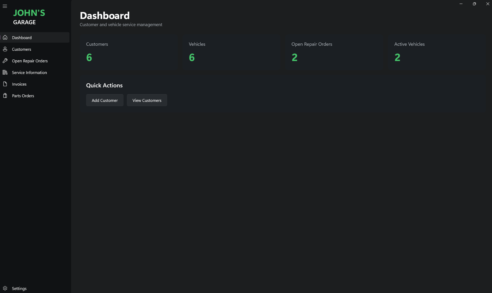
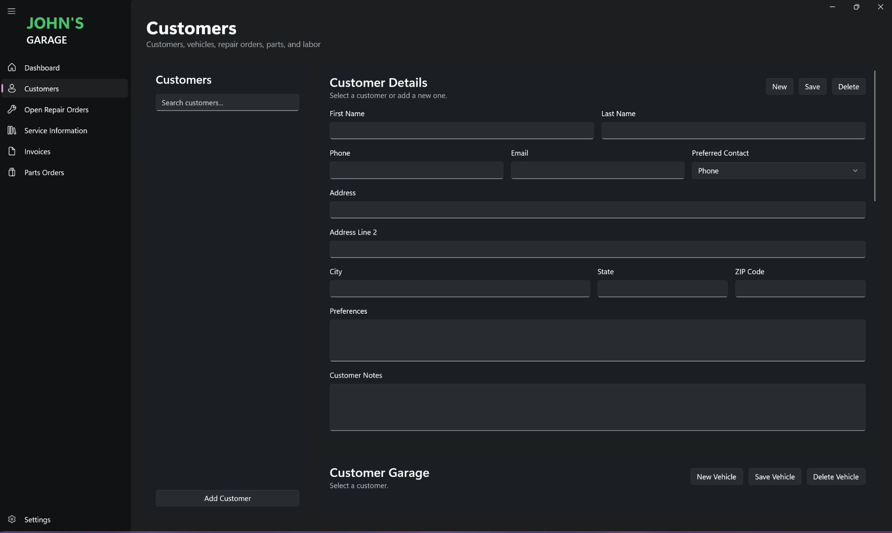
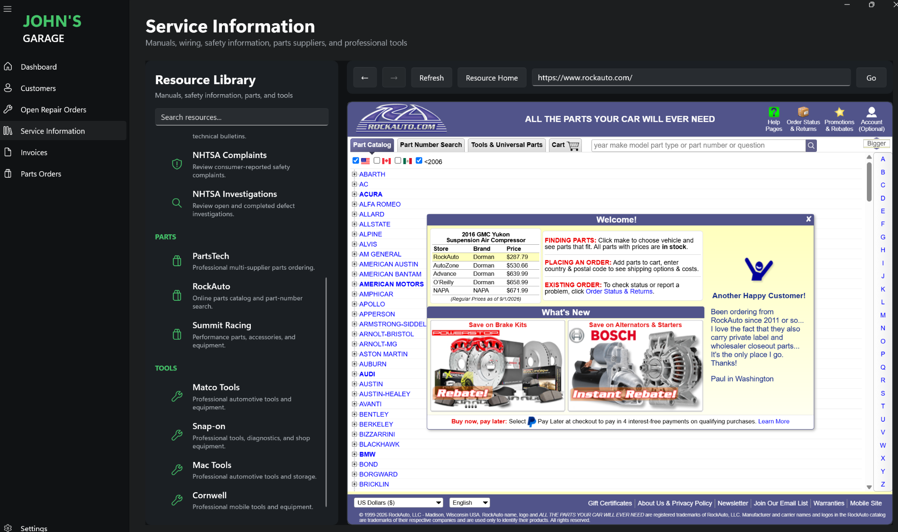
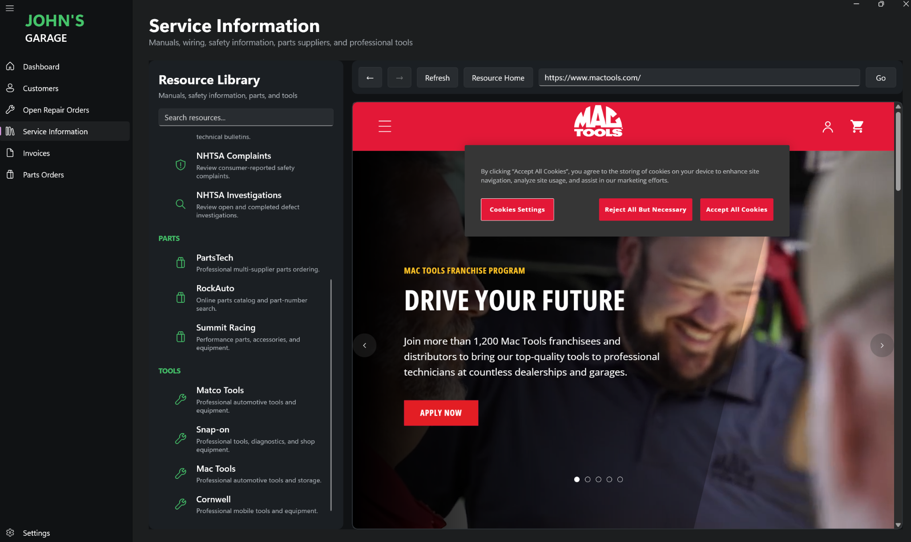
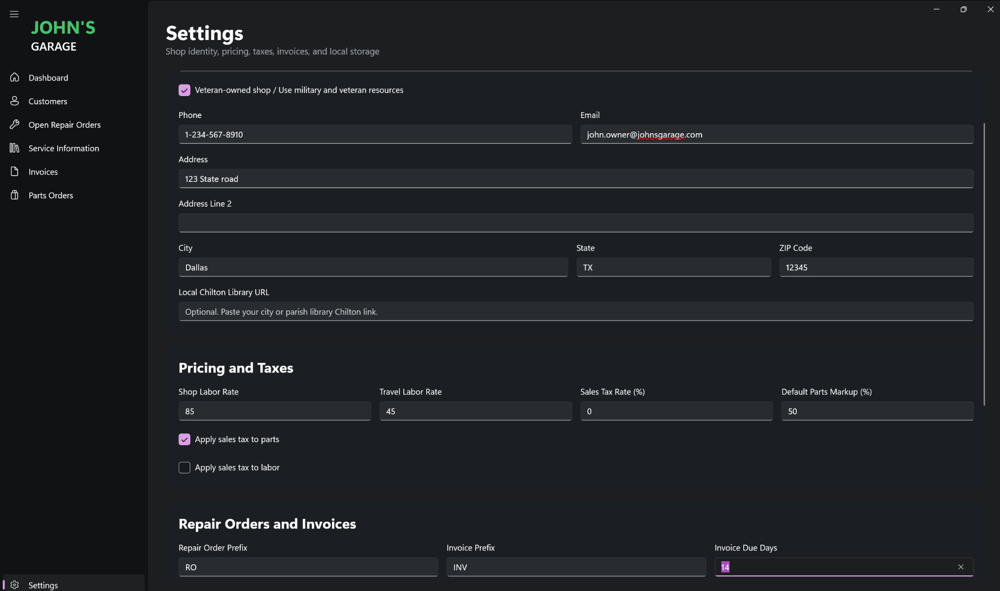

# John's Garage

### Automotive Shop Management Platform | Windows Desktop | C# / .NET / WinUI 3 / EF Core / SQLite

John's Garage is a Windows desktop shop-management application designed around the real workflow of an independent automotive technician. It brings customer and vehicle records, repair orders, parts and labor, purchasing visibility, shop configuration, invoicing workflows, and automotive service resources into a single application.

> **Portfolio edition:** This repository is a sanitized technical showcase. The production application, customer database, credentials, certificates, and proprietary implementation details are intentionally not published.



## What the application solves

Automotive work is relational by nature: a customer owns vehicles; vehicles accumulate repair orders; repair orders consume parts and labor; those items affect estimates, purchasing, completed work, and invoices. John's Garage models that workflow directly instead of treating each screen as an isolated form.

The result is an application built around the chain:

**Customer → Vehicle → Repair Order → Parts & Labor → Parts Orders / Invoice**

## Highlights

- **Customer and vehicle management** with contact preferences, vehicle specifications, mileage, VIN/plate fields, notes, and service relationships.
- **Repair-order workflow** for complaints, diagnosis, work performed, technician notes, scheduling, mileage, parts, and labor.
- **Business calculations** for quoted and performed parts/labor totals and repair-order totals.
- **Parts-order visibility** designed to surface purchasing status, quantities, vendors, costs, and repair-order context.
- **Configurable shop behavior** including labor rates, travel rates, parts markup, taxes, invoice terms, and shop identity.
- **Automotive resource workspace** that provides in-app access to external service-information, parts, supplier, and tool resources.
- **Local relational persistence** using Entity Framework Core and SQLite.

## Customer management



The customer workspace connects customer details to vehicles and repair orders while keeping the operational workflow in one place. The public screenshot is intentionally shown without customer records.

## Automotive resource workspace



The Service Information area acts as a technician resource hub, providing embedded access to external automotive information, parts, supplier, and tool resources from within the application.



Third-party sites and trademarks shown above belong to their respective owners. Their appearance demonstrates external-resource integration only and does not imply affiliation or endorsement.

## Configurable shop settings



Shop behavior can be configured without hard-coding operational values. The settings interface supports shop identity, labor pricing, travel pricing, tax behavior, parts markup, repair-order numbering, and invoice terms. Values shown in this portfolio screenshot are demonstration data.

## Representative architecture

```text
John's Garage
│
├── UI / Views
│   ├── Dashboard
│   ├── Customers & Vehicles
│   ├── Repair Orders
│   ├── Parts Orders
│   ├── Invoices
│   ├── Service Information
│   └── Settings
│
├── Domain Model
│   ├── Customer
│   ├── Vehicle
│   ├── RepairOrder
│   ├── Part
│   └── LaborItem
│
├── Services
│   ├── Shop settings
│   ├── External resource integration
│   └── Application services
│
└── Persistence
    └── Entity Framework Core + SQLite
```

See [`docs/architecture/ARCHITECTURE.md`](docs/architecture/ARCHITECTURE.md) for additional detail.

## Representative code

The [`samples`](samples) directory contains selected, sanitized excerpts from the application's domain and persistence layers. They demonstrate:

- one-to-many relational modeling;
- navigation properties and foreign keys;
- calculated quote/performed totals;
- separation of persisted and display-only values;
- Entity Framework Core relationship configuration; and
- SQLite-backed local persistence.

These excerpts are deliberately limited. They are not intended to reproduce the complete production application.

## Development approach

John's Garage combines automotive domain knowledge with iterative software development. Requirements were derived from real shop workflows, translated into application behavior, implemented and refined with AI-assisted development where useful, then reviewed, debugged, and validated against the intended operational outcome.

That process included defining requirements, directing implementation toward specific behaviors, evaluating generated code and UI results, identifying defects or deviations, debugging, refining requirements, and validating the finished workflow.

## Technology

| Area | Technology |
|---|---|
| Language | C# |
| Platform | .NET / Windows |
| UI | WinUI 3 / XAML |
| Data access | Entity Framework Core |
| Database | SQLite |
| Architecture | Relational domain model with service and view layers |
| Development | Visual Studio, Git |

## Privacy and production-data protection

The operational version of John's Garage is used with real customer information. This public portfolio therefore excludes:

- the production SQLite database and sidecar files;
- customer names, phone numbers, addresses, VINs, and repair histories;
- private certificates and signing material;
- credentials, tokens, and local secrets;
- production-specific configuration; and
- selected proprietary implementation code.

Screenshots included here were selected or sanitized for public display.

## Status

**Active project / portfolio showcase.** The production application remains private while this repository documents representative engineering work and product capabilities.

## Copyright

Copyright © 2026 John Merello. All rights reserved.

This repository is provided for portfolio review and is **not an open-source release**. See [`NOTICE.md`](NOTICE.md) for usage restrictions.
